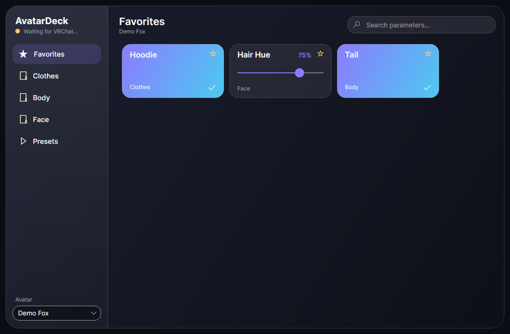

# AvatarDeck

A floating VR tablet for SteamVR that controls VRChat avatar parameters over OSC —
a full replacement for the radial (R) menu, built for people whose controller sticks drift.
Point, click, done: no joystick needed.



## Status

| Phase | Content | State |
|---|---|---|
| 1 | Solution skeleton, DI host, logging, dark glass theme | ✅ |
| 2 | OSC codec, UDP transport, VRChat client, avatar change detection, full-state sync (OSCQuery) | ✅ |
| 3 | Domain model, JSON profiles, auto-generation from VRChat OSC config | ✅ |
| 4 | Tablet UI: tabs, folders/pages, search, favorites, presets, toasts | ✅ first version |
| 5 | SteamVR overlay (offscreen render → D3D11 → `IVROverlay`) | ⏳ |
| 6 | Laser pointer, trigger click, grab/move/resize, lock, opacity | ⏳ |
| 7 | Unity project importer (Expression Parameters / Menus) | ⏳ |
| 8 | Macros, hotkeys, local API, MIDI, Stream Deck, plugins, themes, import/export | ⏳ |
| 9 | Footprint tuning (< 100 MB, < 1 % CPU idle), installer, SteamVR auto-start | ⏳ |

## Build & run

Requirements: Windows 10/11, .NET 8 SDK.

```bash
dotnet build
dotnet test
dotnet run --project src/AvatarDeck.App
```

In VRChat, enable OSC (Action menu → Options → OSC → Enabled). AvatarDeck sends to `127.0.0.1:9000`
and listens on `127.0.0.1:9001` (configurable in `appsettings.json` or `%AppData%\AvatarDeck\settings.json`).

### Developing without VRChat

```bash
# once: create an isolated data folder with the demo profile
mkdir -p .devdata/avatars && cp samples/avatars/avtr_demo.json .devdata/avatars/
# terminal 1 — the app
dotnet run --project src/AvatarDeck.App -- --data-dir ./.devdata
# terminal 2 — a fake VRChat: prints what AvatarDeck sends, echoes it back, switches avatar
dotnet run --project tools/OscSniffer -- --avatar avtr_demo
```

`tools/UiSnapshot` renders the UI offscreen to PNG (`docs/screenshots`).

## Profiles

One JSON file per avatar in `%AppData%\AvatarDeck\avatars\{avatarId}.json`
(see [samples/avatars/avtr_demo.json](samples/avatars/avtr_demo.json)):

```jsonc
{
  "avatarId": "avtr_…",
  "folders": [
    { "name": "Clothes", "widgets": [
        { "kind": "toggle", "label": "Hoodie", "parameter": "Hoodie", "parameterType": "Bool", "onValue": true, "offValue": false },
        { "kind": "slider", "label": "Hair Hue", "parameter": "HairHue", "parameterType": "Float", "minimum": 0, "maximum": 1 }
    ], "children": [] }
  ],
  "presets": [ { "name": "Casual", "values": [ { "parameter": "HairHue", "value": 0.75 } ] } ],
  "favorites": [ "…widget id…" ]
}
```

When VRChat reports a new avatar, AvatarDeck loads its profile, or generates one automatically from the
live parameter list (OSCQuery) or the OSC config VRChat writes in `%LocalAppData%Low\VRChat\VRChat\OSC`.

Auto-organisation: `Folder/Name` paths become folders (VRCFury `VF123_` prefixes removed), flat VRCFury prefab
parameters go to "Extras", VRCFury internals (local copies, compressor, version markers) are dropped, and
GoGo Loco / tracking / smoothing parameters go to a hidden "System" folder. Inside a page, controls are grouped
into sections by their first word (Hair → Hue, Swap).

**Edit mode** (pencil, top right): click any control to rename it, change its type (toggle / button / slider),
hide it, reorder it or move it to another folder; edit folders (name, icon, color, visibility, order, pages);
"Auto-organize" rebuilds the layout from scratch (favorites and presets are kept). Everything is laser-friendly.

## Architecture

```
src/
  AvatarDeck.Core            domain: models, OscValue, interfaces, ProfileBuilder/Manager, presets
  AvatarDeck.Osc             OSC 1.0 codec, UDP transport, VrcOscClient (coalescing, feedback, avatar change)
  AvatarDeck.Infrastructure  JSON profile store (atomic, source-generated), VRChat OSC config reader, paths
  AvatarDeck.UI              Avalonia views + MVVM view models, Glass theme
  AvatarDeck.App             composition root: generic host, DI, Serilog, Avalonia startup
tests/                       xUnit: codec, loopback UDP client, persistence, profile generation
tools/OscSniffer             fake VRChat for development
tools/UiSnapshot             headless offscreen renderer → PNG
docs/adr/                    architecture decision records
```

Design decisions are recorded in [docs/adr](docs/adr/0001-architecture.md).
